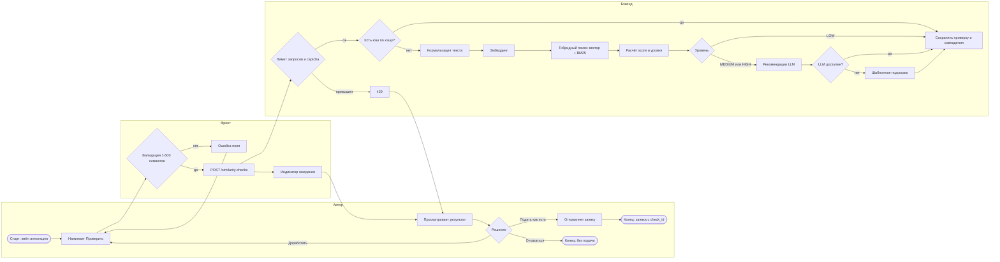
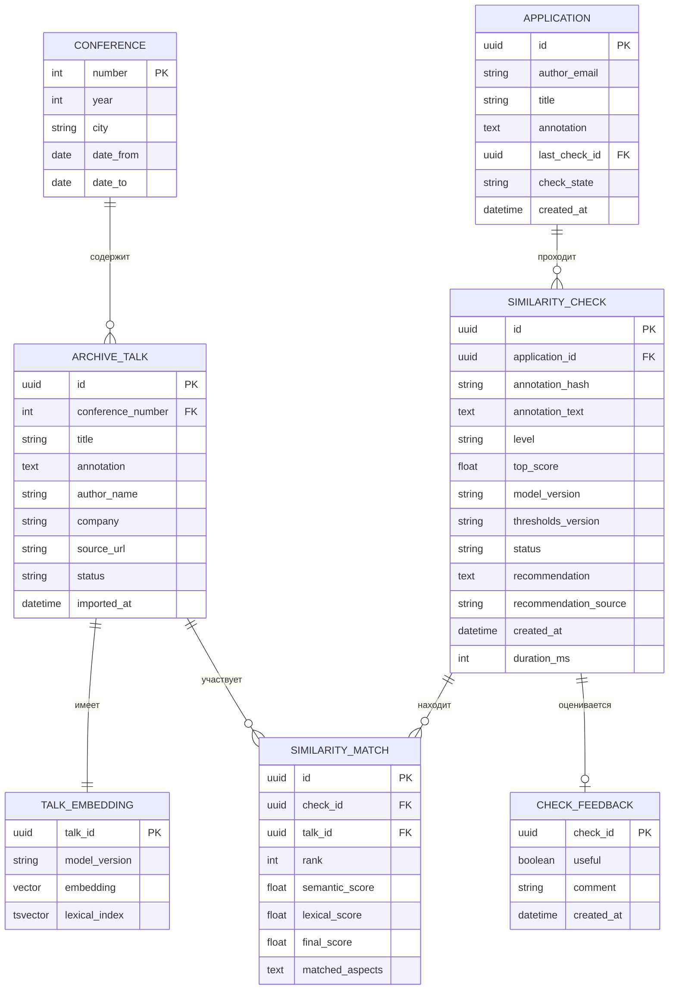

# Техническое задание: проверка аннотации доклада на пересечения с архивом Analyst Days

Версия 2. Функция: «Проверка схожести аннотации» на сайте подачи заявок.

Префиксы требований: БТ (бизнес), ФТ (функциональные), ИТ (интерфейс), ДТ (данные), АТ (API), НТ (нефункциональные). Пороги и лимиты являются допущениями до калибровки.

## 1. Цель, границы, бизнес-требования

**Цель.** Повысить качество докладов при подаче через снижение числа заявок, похожих на ранее принятые доклады Analyst Days.

**В границах:** ввод аннотации (до 500 символов), сверка с принятыми докладами архива за последние 10 лет, показ похожих докладов, уровня пересечения и рекомендаций, привязка проверки к заявке.

**Вне границ:** общая форма заявки, кураторство, оценка программным комитетом, слайды и видео, сравнение заявок одной волны между собой.

| №    | Бизнес-требование                                                                                       |
| ---- | ------------------------------------------------------------------------------------------------------- |
| БТ-1 | Система должна снижать долю заявок с высоким пересечением с архивом (`HIGH`) на 30% к предыдущей волне. |
| БТ-2 | Не менее 80% авторов должны проходить проверку до подачи заявки.                                        |
| БТ-3 | Не менее 40% авторов, получивших `HIGH` или `MEDIUM`, должны изменить аннотацию.                        |
| БТ-4 | Проверка носит рекомендательный характер и не блокирует подачу заявки.                                  |
| БТ-5 | Для сравнения используются только принятые доклады архива, так как данных об отклонённых заявках нет.   |

## 2. Процесс и функциональные требования



| №     | Функциональное требование                                                                                                                                      |
| ----- | -------------------------------------------------------------------------------------------------------------------------------------------------------------- |
| ФТ-1  | Система принимает аннотацию длиной от 1 до 500 символов.                                                                                                       |
| ФТ-2  | Система нормализует текст (регистр, пробелы, пунктуация) перед сравнением.                                                                                     |
| ФТ-3  | Система сравнивает аннотацию со всеми принятыми докладами архива за 10 лет.                                                                                    |
| ФТ-4  | Сравнение комбинирует семантическое сходство (эмбеддинги) и лексическое (BM25). Название доклада учитывается как отдельный признак.                            |
| ФТ-5  | Система рассчитывает итоговый score от 0 до 1 и определяет уровень: `LOW` < 0,60, `MEDIUM` 0,60-0,80, `HIGH` > 0,80 (стартовые значения, подлежат калибровке). |
| ФТ-6  | Система возвращает от 3 до 5 наиболее похожих докладов с названием, конференцией, годом, автором, ссылкой и оценкой сходства.                                  |
| ФТ-7  | Для уровней `MEDIUM` и `HIGH` система формирует рекомендацию по доработке (что совпадает и как изменить ракурс).                                               |
| ФТ-8  | При недоступности LLM система выдаёт шаблонную подсказку и помечает источник рекомендации как «шаблон».                                                        |
| ФТ-9  | Если аннотация уже проверялась (совпадает `annotation_hash`), система возвращает сохранённый результат без пересчёта.                                          |
| ФТ-10 | Система сохраняет каждую проверку и её совпадения с версиями модели и порогов.                                                                                 |
| ФТ-11 | Заявка сохраняется со ссылкой на проверку (`check_id`) либо с признаком `not_checked`.                                                                         |
| ФТ-12 | Система проверяет, что хэш аннотации в заявке совпадает с хэшем проверки, и при несовпадении отклоняет подачу кодом `CHECK_OUTDATED`.                          |
| ФТ-13 | Система принимает оценку полезности проверки и необязательный комментарий.                                                                                     |
| ФТ-14 | Система ограничивает частоту проверок и требует капчу для анонимных пользователей (стартово 10 проверок в час на сессию).                                      |

## 3. Сценарии использования

| №    | Требование к интерфейсу                                                                         |
| ---- | ----------------------------------------------------------------------------------------------- |
| ИТ-1 | Уровень пересечения показывается цветом и текстом одновременно.                                 |
| ИТ-2 | Для `HIGH` выводится предупреждение, а не запрет подачи.                                        |
| ИТ-3 | По умолчанию показывается не более 5 совпадений с фрагментом аннотации и признаками совпадения. |
| ИТ-4 | В карточке похожего доклада показываются только поля из публичного архива.                      |
| ИТ-5 | Введённый текст сохраняется на форме при любой ошибке.                                          |

### UC-1. Ввод аннотации

**Актор:** Автор доклада.

**Предусловие:** Автор открыл форму подачи заявки, поле «Аннотация» доступно.

**Основной поток:**

1. Автор вводит или вставляет текст в поле «Аннотация».
2. Система обновляет счётчик `n/500` и активирует кнопку «Проверить», если длина от 1 до 500 символов.
3. Автор продолжает редактировать текст.
4. Система пересчитывает счётчик и снимает признак «проверка актуальна», если текст изменился после последней проверки.

**А1. Текст длиннее 500 символов**

1. Автор вставляет текст длиннее 500 символов.
2. Система показывает счётчик красным, выводит сообщение «Максимум 500 символов» и блокирует кнопку «Проверить».
3. Автор сокращает текст.
4. Система снимает ошибку и активирует кнопку.

**А2. Поле пустое**

1. Автор удаляет весь текст.
2. Система блокирует кнопку «Проверить» и показывает подсказку «Введите аннотацию».

### UC-2. Запуск проверки (отсутствует в базовой реализации)

**Актор:** Автор доклада.

**Предусловие:** Аннотация введена и проходит валидацию, лимит запросов не превышен.

**Основной поток:**

1. Автор нажимает «Проверить».
2. Система блокирует кнопку, показывает индикатор ожидания и отправляет `POST /similarity-checks`.
3. Автор ожидает результата.
4. Система нормализует текст, строит эмбеддинг, ищет по архиву, рассчитывает уровень пересечения и сохраняет проверку.
5. Автор видит результат.
6. Система отображает экран результата (UC-3) и снимает блокировку кнопки.

**А1. Проверка длится дольше 5 секунд**

1. Автор ожидает результата.
2. Система получает статус `PENDING` и опрашивает `GET /similarity-checks/{id}` раз в 1-2 секунды, не дольше 30 секунд.
3. Автор продолжает ожидать.
4. Система получает `DONE` и отображает результат.

**А2. Лимит запросов исчерпан (429)**

1. Автор нажимает «Проверить».
2. Система получает 429, показывает «Лимит проверок исчерпан, повторите через N минут» и предлагает подать заявку без проверки.
3. Автор выбирает «Подать без проверки».
4. Система переходит к UC-7, А2.

**А3. Сервис недоступен (503) или таймаут**

1. Автор нажимает «Проверить».
2. Система получает 503 или превышает таймаут 30 секунд, показывает ошибку и кнопки «Повторить» и «Подать без проверки».
3. Автор нажимает «Повторить».
4. Система отправляет запрос повторно.

**А4. Та же аннотация уже проверялась**

1. Автор нажимает «Проверить».
2. Система находит проверку с тем же `annotation_hash`, возвращает её из кэша и показывает результат без пересчёта.

### UC-3. Просмотр результата проверки

**Актор:** Автор доклада.

**Предусловие:** Проверка завершена со статусом `DONE`.

**Основной поток:**

1. Автор открывает экран результата.
2. Система показывает уровень (`LOW`, `MEDIUM`, `HIGH`) цветом и текстом и список из 3-5 похожих докладов с названием, конференцией, годом и оценкой сходства.
3. Автор просматривает список.
4. Система отображает для каждого совпадения фрагмент аннотации и признаки совпадения.

**А1. Уровень `LOW`**

1. Автор открывает экран результата.
2. Система показывает «Существенных пересечений не найдено» и 1-3 ближайших доклада для справки.
3. Автор переходит к подаче заявки.
4. Система активирует кнопку «Подать заявку».

**А2. Уровень `HIGH`**

1. Автор открывает экран результата.
2. Система показывает предупреждение «Похожая тема уже была», не блокирует подачу и выводит рекомендации (UC-5).

**А3. Совпадений нет совсем**

1. Автор открывает экран результата.
2. Система показывает уровень `LOW` и сообщение «Похожие доклады не найдены».

### UC-4. Просмотр карточки похожего доклада

**Актор:** Автор доклада.

**Предусловие:** На экране результата показан список совпадений.

**Основной поток:**

1. Автор нажимает на название похожего доклада.
2. Система раскрывает карточку: название, конференция и год, автор, компания, полная аннотация, ссылка на архив.
3. Автор нажимает «Открыть в архиве».
4. Система открывает страницу доклада в архиве в новой вкладке.

**А1. Страница архива недоступна**

1. Автор нажимает «Открыть в архиве».
2. Система сообщает о недоступности ссылки и оставляет раскрытой карточку с данными из системы.

### UC-5. Просмотр рекомендаций по доработке

**Актор:** Автор доклада.

**Предусловие:** Уровень проверки `MEDIUM` или `HIGH`.

**Основной поток:**

1. Автор открывает блок «Как доработать тему».
2. Система показывает рекомендацию: что совпадает с архивом и какие ракурсы можно изменить (кейс, отрасль, глубина, формат).
3. Автор читает рекомендацию.
4. Система предлагает кнопки «Исправить аннотацию» и «Подать как есть».

**А1. LLM недоступен**

1. Автор открывает блок рекомендаций.
2. Система показывает шаблонную подсказку с пометкой «шаблон». Список совпадений остаётся доступным.

### UC-6. Исправление аннотации и повторная проверка

**Актор:** Автор доклада.

**Предусловие:** Автор просмотрел результат и решил изменить текст.

**Основной поток:**

1. Автор нажимает «Исправить аннотацию».
2. Система возвращает фокус в поле ввода с сохранённым текстом. После первой правки предыдущий результат остаётся в блоке «История проверок» с пометкой «устарел».
3. Автор вносит правки и нажимает «Проверить».
4. Система запускает новую проверку по UC-2.
5. Автор сравнивает новый результат с предыдущим.
6. Система показывает изменение уровня и оценки (например, `HIGH` -> `MEDIUM`).

**А1. Автор вернул прежний текст**

1. Автор восстанавливает прежнюю аннотацию и нажимает «Проверить».
2. Система находит кэш по `annotation_hash` и возвращает прежний результат (UC-2, А4).

### UC-7. Подача заявки с результатом проверки (требует интеграции с основным ресурсом)

**Актор:** Автор доклада.

**Предусловие:** Обязательные поля заявки заполнены, приём заявок открыт.

**Основной поток:**

1. Автор нажимает «Подать заявку».
2. Система проверяет, что проверка выполнена для текущей версии аннотации, и отправляет `POST /applications` с `check_id`.
3. Автор подтверждает отправку.
4. Система сверяет хэш аннотации с хэшем проверки, сохраняет заявку со ссылкой на проверку и показывает подтверждение.

**А1. Аннотация изменилась после проверки (409)**

1. Автор нажимает «Подать заявку».
2. Система получает `CHECK_OUTDATED`, не отправляет заявку и предлагает перепроверить аннотацию.
3. Автор нажимает «Проверить».
4. Система запускает UC-2.

**А2. Подача без проверки**

1. Автор нажимает «Подать без проверки».
2. Система показывает предупреждение «Не проверено на пересечения с архивом».
3. Автор подтверждает.
4. Система сохраняет заявку со статусом `not_checked`.

**А3. Подача при уровне `HIGH`**

1. Автор нажимает «Подать заявку».
2. Система показывает подтверждение «Найдено высокое пересечение. Подать всё равно?».
3. Автор нажимает «Подать всё равно».
4. Система сохраняет заявку с `check_id` и уровнем `HIGH` без блокировки.

### UC-8. Оценка полезности проверки

**Актор:** Автор доклада.

**Предусловие:** Результат проверки показан на экране.

**Основной поток:**

1. Автор нажимает «Полезно» или «Не полезно».
2. Система сохраняет оценку через `POST /similarity-checks/{id}/feedback` и показывает поле комментария.
3. Автор вводит комментарий и нажимает «Отправить».
4. Система сохраняет комментарий и показывает «Спасибо за отзыв».

**А1. Автор не оставил комментарий**

1. Автор закрывает поле комментария без ввода.
2. Система сохраняет только оценку.

**А2. Оценка уже была отправлена**

1. Автор повторно нажимает кнопку оценки.
2. Система обновляет сохранённую оценку для этой проверки и не создаёт дубль.

### UC-9. Обработка ошибок и недоступности сервиса (отсутствует в базовой реализации)

**Актор:** Автор доклада.

**Предусловие:** Автор запустил проверку, и бэкенд вернул ошибку.

**Основной поток:**

1. Автор запускает проверку.
2. Система получает код ошибки (400, 429, 503 или таймаут) и сопоставляет его с понятным сообщением.
3. Автор читает сообщение.
4. Система предлагает действия, подходящие для ошибки: исправить текст, повторить, подождать или подать без проверки.

**А1. Ошибка валидации (400)**

1. Автор запускает проверку с некорректным текстом.
2. Система выделяет поле «Аннотация» и показывает причину.

**А2. Потеря соединения**

1. Автор запускает проверку при потере сети.
2. Система показывает «Нет соединения», сохраняет введённый текст и предлагает повторить.
3. Автор нажимает «Повторить» после восстановления сети.
4. Система повторно отправляет запрос.

## 4. Модель данных



| №    | Таблица            | Назначение                                                                                                                                                                                 |
| ---- | ------------------ | ------------------------------------------------------------------------------------------------------------------------------------------------------------------------------------------ |
| ДТ-1 | `CONFERENCE`       | Справочник конференций Analyst Days: номер, год, город, даты. Нужен для привязки докладов и отбора архива за 10 лет.                                                                       |
| ДТ-2 | `ARCHIVE_TALK`     | Корпус принятых докладов архива: название, аннотация, автор, компания, ссылка на страницу. Эталонный набор для сравнения.                                                                  |
| ДТ-3 | `TALK_EMBEDDING`   | Поисковые представления доклада: вектор эмбеддинга и лексический индекс. Хранятся отдельно, чтобы пересчитывать при смене модели.                                                          |
| ДТ-4 | `APPLICATION`      | Заявка автора с названием и аннотацией; ссылка на последнюю проверку и состояние проверки (`checked`, `not_checked`).                                                                      |
| ДТ-5 | `SIMILARITY_CHECK` | Факт проверки: хэш и текст аннотации, уровень, максимальный score, версии модели и порогов, рекомендация и её источник, время выполнения. Обеспечивает кэш, воспроизводимость и аналитику. |
| ДТ-6 | `SIMILARITY_MATCH` | Найденные совпадения проверки: какие доклады архива признаны похожими, с позицией, составляющими оценки и признаками совпадения.                                                           |
| ДТ-7 | `CHECK_FEEDBACK`   | Оценка автором полезности проверки и комментарий. Используется для калибровки порогов и улучшения рекомендаций.                                                                            |

| №     | Требование к данным                                                                                                                                         |
| ----- | ----------------------------------------------------------------------------------------------------------------------------------------------------------- |
| ДТ-8  | Поле `status` в `ARCHIVE_TALK` пока всегда имеет значение «принят» и оставлено на случай появления данных об отклонённых заявках.                           |
| ДТ-9  | В `SIMILARITY_CHECK` обязательно хранятся `model_version` и `thresholds_version`.                                                                           |
| ДТ-10 | Срок хранения текстов проверок и состав персональных данных определяются отдельным решением. До него тексты используются только для аналитики и калибровки. |
| ДТ-11 | В архив загружаются доклады за последние 10 лет. Слайды и видео не загружаются.                                                                             |

## 5. API и нефункциональные требования

Базовый путь `/api/v1`, формат JSON, UTF-8.

| №    | Метод и путь                            | Назначение                                                                                                                                                   |
| ---- | --------------------------------------- | ------------------------------------------------------------------------------------------------------------------------------------------------------------ |
| АТ-1 | `POST /similarity-checks`               | Создать проверку (тело: `annotation`, необязательные `title`, `session_id`) и вернуть результат. При длительной обработке вернуть 202 со статусом `PENDING`. |
| АТ-2 | `GET /similarity-checks/{id}`           | Получить результат проверки или её статус.                                                                                                                   |
| АТ-3 | `POST /similarity-checks/{id}/feedback` | Отправить оценку `useful` и необязательный `comment`.                                                                                                        |
| АТ-4 | `POST /applications`                    | Подать заявку с `title`, `annotation`, `check_id` (в части, относящейся к функции).                                                                          |

Пример ответа АТ-1 и АТ-2 при `DONE`:

```json
{
  "id": "b3e1...",
  "status": "DONE",
  "level": "MEDIUM",
  "top_score": 0.72,
  "matches": [
    {
      "rank": 1,
      "talk_id": "7f2a...",
      "title": "...",
      "conference_number": 21,
      "year": 2025,
      "author": "...",
      "annotation": "...",
      "score": 0.72,
      "url": "https://analystdays.ru/...",
      "matched_aspects": ["тема", "аудитория"]
    }
  ],
  "recommendation": "...",
  "recommendation_source": "LLM",
  "created_at": "2026-11-21T07:00:00Z"
}
```

| №    | Код | Условие                                         | Тело                                          |
| ---- | --- | ----------------------------------------------- | --------------------------------------------- |
| АТ-5 | 400 | Пустая аннотация или длиннее 500 символов       | `{"error":"VALIDATION","field":"annotation"}` |
| АТ-6 | 404 | Проверка не найдена                             | `{"error":"NOT_FOUND"}`                       |
| АТ-7 | 409 | Хэш аннотации в заявке не совпадает с проверкой | `{"error":"CHECK_OUTDATED"}`                  |
| АТ-8 | 429 | Превышен лимит                                  | `{"error":"RATE_LIMIT","retry_after":600}`    |
| АТ-9 | 503 | Сервис проверки недоступен                      | `{"error":"UNAVAILABLE"}`                     |

| №    | Нефункциональное требование                                                                                                |
| ---- | -------------------------------------------------------------------------------------------------------------------------- |
| НТ-1 | Время ответа проверки p95 не более 5 с без LLM и не более 10 с с LLM.                                                      |
| НТ-2 | Система выдерживает около 500 заявок за волну с пиком у дедлайна и многократными перепроверками.                           |
| НТ-3 | Пороги и веса методов калибруются на размеченной выборке не менее 150-200 пар докладов, размеченных программным комитетом. |
| НТ-4 | Передача данных только по HTTPS.                                                                                           |
| НТ-5 | Использование внешнего LLM или эмбеддинг-API согласуется отдельно. Альтернатива: локальная модель.                         |
| НТ-6 | Журналируются версии моделей, пороги, время ответа и обратная связь.                                                       |
| НТ-7 | Результат показывает год и контекст совпадений, чтобы популярные темы не отсекались автоматически.                         |

## Открытые вопросы

1. Право использования данных архива и персональных данных авторов.
2. Срок хранения текстов проверок.
3. Внешний или локальный LLM.
4. Итоговые пороги после калибровки.
